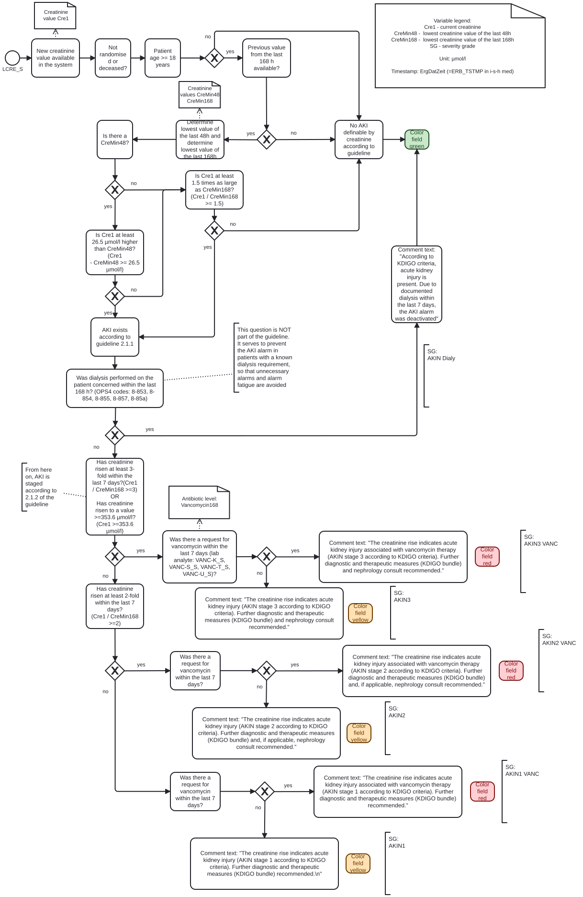

# AKI algorithm - *Product Name*

|                      |                 |
| -------------------- | --------------- |
| **Template ID**      | *Local ID*      |
| **Template Version** | *Version*       |
| **Approval**         | *Approver name* |

There is a also a [BPMN-Version](assets/230302_AKI_V1.6.bpmn) stored.