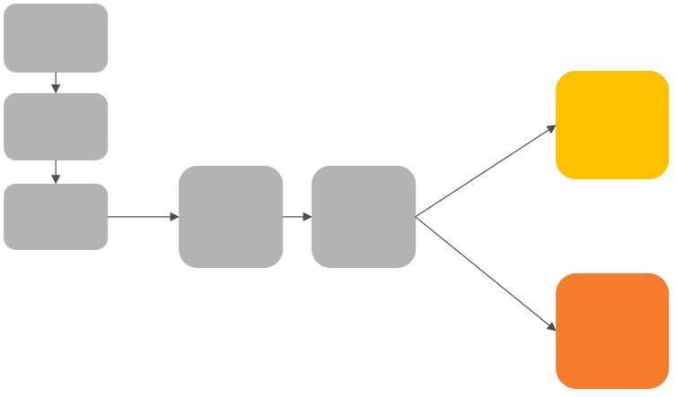

# Instructions for Use - *Product Name*

|                      |                 |
| -------------------- | --------------- |
| **Template ID**      | *Local ID*      |
| **Template Version** | *Version*       |
| **Approval**         | *Approver name* |

# 1. Introduction

## 1.1 Overview

| Product |                |
| ------- | -------------- |
| Name    | *Product name* |
| Version | 1.0            |
| Date    | Day-Month-Year |

*Product name* is a class IIa medical device according to Regulation (EU) 2017/745.

| Manufacturer |  |
|---|---|
| Name | *Hospital Name* |
| Address | *local manufacturer address* |
| Email | *local email address* |
| Website | *local website* |

## 1.2 Definitions and Symbols

| Term           | Definition                                           |
| -------------- | ---------------------------------------------------- |
| AKI            | Acute kidney injury                                  |
| CDSS           | Clinical decision support system                     |
| KDIGO          | Kidney Disease: Improving Global Outcomes            |
| HIS            | Hospital information system                          |
| *Product name* | Product name of the clinical decision support system |
| CWS            | Clinical Workstation System                          |

| Symbol | Meaning                                |
| ------ | -------------------------------------- |
| ⚠      | Indicates important safety information |
| (i)    | Indicates supplementary information    |

# 2. Product Description

## 2.1 Intended Purpose

*Product name* is a clinical decision support system that draws attention to potentially undetected or unnoticed medical conditions at *Hospital Name* and provides interpretive assistance.

These conditions, also referred to below as algorithms, are detected using rule sets based on guidelines and expert knowledge. Specifically, these are:

- Acute kidney injury according to the KDIGO guideline
- Vancomycin-associated kidney injury

## 2.2 Patient Population

*Product name* is intended for use in adult patients (>=18 years) at *Hospital Name*. Patients of all genders are considered. Inclusion is independent of origin, pre-existing conditions, or ethnicity, provided that medical care is within the application scope.

## 2.3 User Profiles

Intended users of *product name* are licensed physicians and pharmacists. The qualification of these professional groups includes all necessary subject-matter knowledge for use. *Product name* is designed so that no additional technical training is required. Users can find detailed information on all product-specific functions in section 6, Use and Maintenance.

## 2.4 Operating Environment

Users can access *product name* from *local hospital workstations*. They must have a valid account for the local Hospital Information System (HIS). In each ward overview of the Clinical Workstation System (CWS), a status column (*product name* CDSS) can be displayed. From there, one click leads directly to the *product name* user interface.

## 2.5 Exclusions from Use

*Product name* must not be used in environments with substantial interference potential, strong distraction, or unstable network connectivity. Use is prohibited in places where readability of notifications or independent verification of results is not ensured.

Unauthorized persons, see section 2.3 User Profiles, must not use *product name*. Use by laypersons is therefore excluded.

# 3. Safety Information

---

⚠ No medical consequence may be derived solely from a *product name* notification. Notifications must always be reviewed critically and assessed in the overall context.

---

## 3.1 Indications and Contraindications

There are no restrictions regarding indications and contraindications for the use of *product name*. The user must be able to understand the medical indication in order to decide whether *product name* is suitable for the respective patient.

## 3.2 Foreseeable Misuse

Foreseeable misuse includes, among other things, use of *product name* by insufficiently trained staff, operation under time pressure or distraction, and ignoring warnings. Patient mix-ups, incorrect interpretation of outputs, and over-reliance on the notification are also included.

# 4. Language

*Product name* supports use only in German.

# 5. System Requirements

Users do not need to observe any additional requirements regarding hardware, software, security, or installation. After deployment, *product name* is directly integrated into the CWS and is provided ready for use by the manufacturing department; see section 2.4 Operating Environment.

# 6. Use and Maintenance

## 6.1 Introduction

This section provides an overview of the use of the *product name* clinical decision support system at *Hospital Name*. The system performs real-time analyses of patient data and generates automated notifications. The user interface accessible through the CWS supports efficient decision-making and promotes optimal patient care. In addition, the system also informs users by email about critical and warning conditions.

The system displays one status indicator per patient in the CWS. From this status indicator, users can jump directly to the user interface to obtain further details.

---

⚠ No medical consequence may be derived solely from a *product name* notification. Notifications must always be reviewed critically and assessed in the overall context.

---

## 6.2 Information on AI Content

The scoring algorithms of the CDSS contain AI content to varying degrees. In the current version, none of the algorithms is based on generative AI, deep learning, or machine learning. The degree of AI content of the respective algorithms is described below:

| Algorithm | Degree of AI content | Short explanation |
|---|---|---|
| Acute kidney injury (AKI) | Expert system / symbolic AI | Based on the KDIGO guideline, predefined notifications are output based on the scoring algorithm; see section 6.7 Active Algorithms. |
| Vancomycin-associated AKI | Expert system / symbolic AI | Based on the KDIGO guideline and expert knowledge of the patient population at *Hospital Name*, predefined notifications are output based on the scoring algorithm; see section 6.7 Active Algorithms. |

## 6.3 Configuration: Activation in the Clinical Workstation

To enable the use of *product name*, it must be configured in the clinical workstation; i.e., a column for displaying the status must be shown once. This is done in the SAP IS-H/i.s.h.med workstation system in 3 steps:

**Step 1:** Right-click the heading of any column and select “Show…” (Figure 1).

**Step 2:** From the list of available columns that appears (Figure 2), select the column name “*product name* CDSS,” move it over using the left arrow, and confirm with the green check mark.

**Step 3:** The addition of the column to the clinical workstation is saved permanently by clicking the green save button (see Figure 3).

*Figure 1: Placeholder for the local CWS column-configuration screen.*

*Figure 2: Placeholder for the local CWS column-selection screen.*

*Figure 3: Placeholder for the local CWS configuration confirmation.*

## 6.4 Use: Status Indicator in the Clinical Workstation

The status indicator is displayed as a column in the local CWS as a three-level traffic-light symbol. If the bed is empty, the status indicator is empty. A greyed-out traffic light is displayed when no relevant data are available for calculating decision support for the person. In total, five states are possible for display in the column; see Table 1.

Table 1. Possible states of the *product name* CDSS column.

| Symbol                                                                                            | Description | Interpretation                                                                             |
| ------------------------------------------------------------------------------------------------- | ----------- | ------------------------------------------------------------------------------------------ |
| *local green-status symbol*   | Green       | *Product name* has not detected a notifiable condition.                                    |
| *local yellow-status symbol*        | Yellow      | *Product name* has detected a warning condition.                                           |
| *local red-status symbol*                 | Red         | *Product name* has detected a critical condition.                                          |
| *local no-data symbol*                  | Grey        | *Product name* recognizes the person. No relevant data for decision support are available. |
|                                                                                                   | Empty       | *Product name* does not recognize a person in this bed on the ward.                        |

## 6.5 Use: User Interface

The user interface is opened by clicking the status indicator for a person (see section 6.4). This opens a webpage in a new browser window and provides a direct overview of the states of individual algorithms.

As shown in *Figure 4*, the layout is divided into master data, contact data, and status area.

Case master data in the upper left contain patient name, date of birth, and sex. Below this, patient number and medical case ID are listed. The status area follows below. Algorithm states appear as color-coded tiles. Each tile shows the title of the algorithm or state and the time of the most recent detection. The colors indicate severity: red for critical, yellow for warning, grey for no findings. Newer or higher-priority states are shown first.

The list of normal states can be expanded and collapsed using an arrow symbol and is initially closed. If the system has no data for a state category, the corresponding area remains empty and the counter shows 0.

Relevant contact data for *product name* are located in the upper right of every window. The *product name* user interface session is ended by closing the browser window.

*Figure 4: Placeholder for a generic case-dashboard overview.*

Clicking a state tile opens the detail view for the selected algorithm (see *Figure 5*). It contains:

- information about which algorithm is involved, including detected severity;
- notification text summarizing the recommended assessment;
- a history of the relevant laboratory parameter in the algorithm.

By default, a vertically scrollable table of laboratory parameters is shown with the latest values first. The detected state for each laboratory value is color- and symbol-coded with an adjacent legend. At the bottom there is a switch "Show as chart". Here the user can switch between table view and graphical laboratory value history; see *Figure 6*. For long histories, a horizontal scrollbar is available for navigation.

*Figure 5: Placeholder for a generic AKI detail view with a measurement-history table.*

*Figure 6: Placeholder for a generic AKI detail view with a measurement-history chart.*

## 6.6 Use: Notification by Email

*Product name* automatically sends an email for each detected warning or critical condition (see *Figure 7*) for an example. By default, these emails are received by *local recipient mailbox*. Additional recipients can be configured in consultation with the *local development team* and are generally reserved for intervention or response teams (see manufacturer in section 1.1).

Example subject:

**AKIN 3 - Notification for *patient name* on Day-Month-Year, case *local medical case ID***

Example email:

> Dear Sir or Madam,
>
> *Product name* detected the finding described below.
>
> The creatinine increase indicates acute kidney injury associated with vancomycin therapy (AKIN stage 3 according to KDIGO criteria). Further diagnostic and therapeutic measures and nephrology consultation are recommended.
>
> Patient ID: *local patient ID*
> Case ID: *local medical case ID*
>
> Source system: *local system name*
> Order ID: *local order ID*
>
> Algorithm: AKI
> Version: 1.0
> Severity: AKIN 3 VANC
> Analyte: *local serum-creatinine code*
> Measured value: 358.0 µmol/l
>
> Performance time: Day-Month-Year, Hour:Minute
> Processing time: Day-Month-Year, Hour:Minute
> 
> Sincerely,
> Your *product name* system
>
> --
> 
> Information included in the calculation:
> Minimum creatinine level in the last 2 days: 239 µmol/L
> Minimum creatinine level in the last 7 days: 239 µmol/L
> Was a vancomycin level measured in the last 7 days?: yes
> Was dialysis performed in the last 7 days?: no

*Figure 7: Generic example of a *product name* notification email using local identifiers.*

## 6.7 Active Algorithms

*Product name* can process several algorithms in parallel. All algorithms active at *Hospital Name* are briefly introduced below. Details are provided in the appendix.

### 6.7.1 AKI - Acute Kidney Injury

Acute kidney injury, abbreviated AKI, is a form of renal insufficiency characterized by a rapid decrease in kidney function with the kidney injury being potentially reversible. The duration of acute kidney injury ranges from a few hours to several weeks. The algorithm evaluates serum creatinine according to KDIGO guidelines without considering urine output. Determination of the serum level of the potentially nephrotoxic antibiotic vancomycin is also included when determining severity. The calculated end states (severity levels), input data, and a technical overview of the algorithm are provided in the appendix. Figure 8 provides a simplified overview of the algorithm.

Figure 8: Simplified overview of the AKI algorithm.

# 7. Support

In case of software problems, an error page is displayed. Unexpected disruptions, malfunctions, feedback, and general questions must be reported through the support channels defined by the deployment site. Please reference the locally assigned medical-device identifier for all requests.

| Contact                   | Value                   |
| ------------------------- | ----------------------- |
| Incident reporting        | *local incident portal* |
| General questions         | *local support contact* |
| Medical-device identifier | *local ID number*       |

# 8. Appendix

Table A1. Possible severity levels and accompanying notification texts in the AKI algorithm.

| Severity   | Notification text                                                                                                                                                                                                                                               | Comment               |     |
| ---------- | --------------------------------------------------------------------------------------------------------------------------------------------------------------------------------------------------------------------------------------------------------------- | --------------------- | --- |
| AKIN1      | The creatinine increase indicates acute kidney injury (AKIN stage 1 according to KDIGO criteria). Further diagnostic and therapeutic measures (KDIGO bundle) are recommended.                                                                                   | Warning, yellow state |     |
| AKIN2      | The creatinine increase indicates acute kidney injury (AKIN stage 2 according to KDIGO criteria). Further diagnostic and therapeutic measures (KDIGO bundle) and, if applicable, nephrology consultation are recommended.                                       | Warning, yellow state |     |
| AKIN3      | The creatinine increase indicates acute kidney injury (AKIN stage 3 according to KDIGO criteria). Further diagnostic and therapeutic measures (KDIGO bundle) and nephrology consultation are recommended.                                                       | Warning, yellow state |     |
| AKIN1 VANC | The creatinine increase indicates acute kidney injury in connection with vancomycin therapy (AKIN stage 1 according to KDIGO criteria). Further diagnostic and therapeutic measures (KDIGO bundle) are recommended.                                             | Critical, red state   |     |
| AKIN2 VANC | The creatinine increase indicates acute kidney injury in connection with vancomycin therapy (AKIN stage 2 according to KDIGO criteria). Further diagnostic and therapeutic measures (KDIGO bundle) and, if applicable, nephrology consultation are recommended. | Critical, red state   |     |
| AKIN3 VANC | The creatinine increase indicates acute kidney injury in connection with vancomycin therapy (AKIN stage 3 according to KDIGO criteria). Further diagnostic and therapeutic measures (KDIGO bundle) and nephrology consultation are recommended.                 | Critical, red state   |     |
| AKIN Dialy | The creatinine increase formally fulfills the KDIGO criteria for acute kidney injury. Since dialysis was performed in the last 7 days, no notification is issued.                                                                                               | Green state           |     |

Table A2. Incoming patient data in the AKI algorithm.

| Designation                               | Description                                              | System                                |
| ----------------------------------------- | -------------------------------------------------------- | ------------------------------------- |
| *local serum-creatinine code*             | Laboratory parameter serum creatinine                    | *Local laboratory information system* |
| *local continuous vancomycin-level code*  | Continuous vancomycin level determination                | *Local laboratory information system* |
| *local peak vancomycin-level code*        | Peak vancomycin level determination                      | *Local laboratory information system* |
| *local trough vancomycin-level code*      | Trough vancomycin level determination                    | *Local laboratory information system* |
| *local unspecified vancomycin-level code* | Vancomycin level determination of unknown type           | *Local laboratory information system* |
| OPS 8-853                                 | Procedure hemofiltration                                 | HIS patient record                    |
| OPS 8-854                                 | Procedure hemodialysis                                   | HIS patient record                    |
| OPS 8-855                                 | Procedure hemodiafiltration                              | HIS patient record                    |
| OPS 8-857                                 | Procedure peritoneal dialysis                            | HIS patient record                    |
| OPS 8-85a                                 | Procedure extracorporeal circulation and blood treatment | HIS patient record                    |
